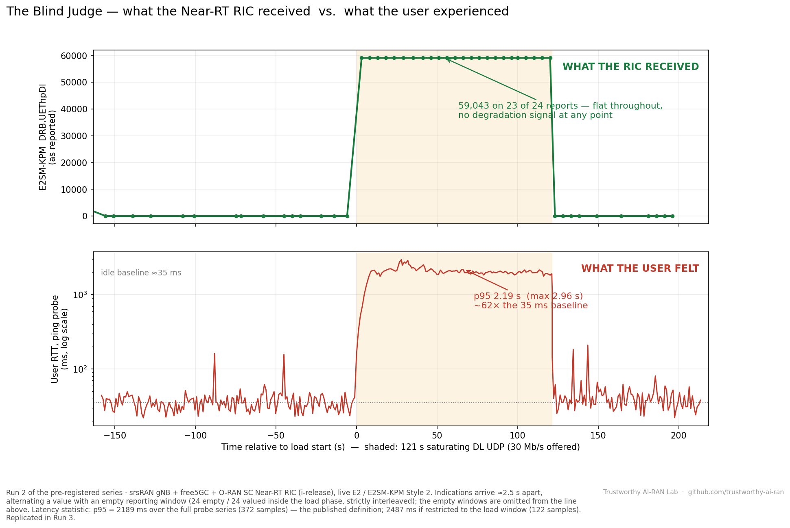
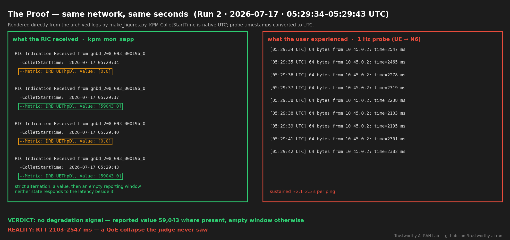
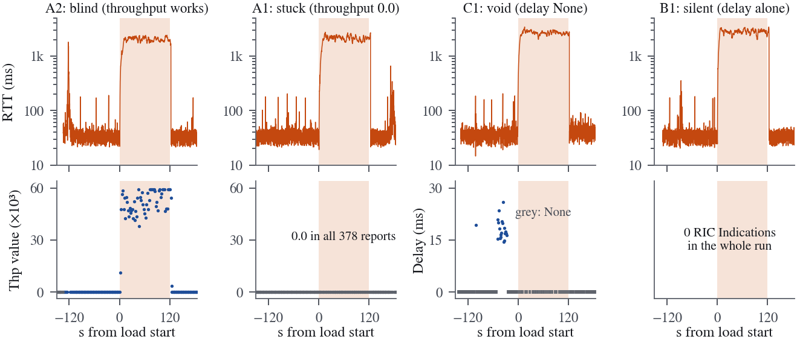

# Trustworthy AI-RAN Lab

An independent, fully open-source research testbed investigating a simple question with large consequences for autonomous networks:

> **Does the AI in the loop know what it cannot see — or does it confidently judge from insufficient telemetry?**

Everything here runs on one Ubuntu 22.04 VM, end-to-end open source: **free5GC** (5G SA core) · **srsRAN Project** (gNB + UE over ZMQ virtual radio) · **O-RAN SC Near-RT RIC** (i-release, live E2 / E2SM-KPM).

---

## UC-06 — "The Blind Judge"

**Finding.** On a live O-RAN E2 interface, a saturating downlink load drove user RTT from ≈40 ms to **p95 ≈ 2.1–2.2 s (max 2.96 s) — a ~50× QoE collapse — while the standard KPM metric `DRB.UEThpDl`, received as live RIC Indications by a monitoring xApp, reported a steady, healthy value for the entire load phase.** Zero degradation signal. The discriminator (a ≈6.17 MB standing queue, `rlc queue_size_bytes`) exists in the gNB's DU-local telemetry — on the wrong side of the E2 interface.



**Method.** Pre-registered A/B/A protocol (hypothesis locked in writing before any data): 60 s idle → 120 s saturating DL UDP (30 Mb/s offered) → 60 s recovery, with two independent witnesses recorded end-to-end — every RIC Indication (xApp log) and a 1 Hz timestamped ICMP probe from the UE. Full protocol: [`uc06-blind-judge/METHOD.md`](uc06-blind-judge/METHOD.md).

**Run accounting (full disclosure).**

| Run | Status | Headline |
|---|---|---|
| 1 | Voided | Procedural fault (probe suspended before writing any sample); reported as voided per protocol |
| 2 | Valid | 372 probe samples · p50 42.8 ms · **p95 2,189 ms** · max 2,956 ms |
| 3 | Valid | 435 probe samples · p50 39.9 ms · **p95 2,125 ms** · max 2,637 ms |

p95 of the two valid runs agree within 3%.

**Time-aligned proof** (verbatim log excerpts, same seconds):



**Why it matters.**
- KPM-green ≠ healthy: any AI agent fed only the standard E2 stream — threshold xApp or LLM copilot — classifies this network as fine.
- A digital twin fed by the same telemetry inherits the blindness and validates the disaster as safe.
- Latency tools exist (TWAMP, QoS monitoring) — but nothing in the loop knows *when* to invoke them; the trigger itself depends on the blind feed.
- The observability gap is implementation-independent evidence for DU-local intelligence (the **dApp** direction — Lacava et al., *Computer Networks* 269, 2025, [doi:10.1016/j.comnet.2025.111342](https://doi.org/10.1016/j.comnet.2025.111342)): their case is *access*; this experiment adds *sufficiency*.
## EXP-02B — silent, order-dependent loss of Indications

Answering the obvious objection to UC-06 — *"why not just subscribe to a delay
metric?"* — surfaced a second effect: adding `DRB.RlcSduDelayDl` to a working
subscription took it from 22 Indications to **zero**, silently, with HTTP 200
and a Subscription ID returned throughout.

That became its own pre-registered experiment.

| Run | Metric list (Report Style 2) | Predicted | Observed |
|---|---|---|---|
| P  | `DRB.UEThpDl` | > 0 | **24** |
| A1 | `DRB.UEThpDl, DRB.RlcSduDelayDl` | 0 | **0** |
| B  | `DRB.RlcSduDelayDl, DRB.UEThpDl` | > 0 | **24** |
| A2 | `DRB.UEThpDl, DRB.RlcSduDelayDl` | 0 | **0** |
| C  | `DRB.UEThpDl, DRB.FakeMetric123` | 0 (diagnostic) | **0** |

**Same two metrics — reversing their order restores the stream, reversing it
back kills it again.** Whether an Indication is emitted at all is decided
solely by the *last* metric in the subscription: the readiness check in
`e2sm_kpm_report_service_style2::collect_measurements` reads a loop-scoped
buffer that only ever holds the last metric's result. If that one yields no
value, the entire Indication is discarded — including metrics already
collected successfully.

Pre-registration, locked analysis rule, mechanism and threats to validity:
[`exp-02b/RESULTS.md`](exp-02b/RESULTS.md)

**Status (October 2026): fixed upstream.** Reported to the OCUDU project as issue
#684 and fixed by the maintainers in merge request !1521: readiness is now
evaluated across all requested metrics, and a missing measurement is sent as
`noValue` so metric order is preserved. Verified independently in
[EXP-02C](#exp-02c--independent-verification-of-the-upstream-fix); shipped in
**OCUDU 26.10**.

## UC-06R — replication with three subscription arms (September 2026)

Same lab and gNB build, re-run with a 5 Hz probe and pre-registered arms to answer
UC-06's open question: what does the xApp receive if it also asks for delay? Under
the same 30 Mb/s load, median RTT went from **33–36 ms to 2.0–2.9 s (56–81×) in
6 of 6 runs**, and no KPM report showed it.

| Subscription (metrics, in order) | What the xApp received | Mode |
|---|---|---|
| `DRB.UEThpDl` (A2, A3) | 56/56 load-window reports non-zero: a busy, healthy-looking cell | blind |
| `DRB.UEThpDl` (A1, same build) | 0.0 in all 378 reports while 22.4 Mb/s reached the UE | stuck |
| `DRB.RlcSduDelayDl` (B1, B2) | subscription accepted, zero Indications in the whole run | silent |
| `DRB.RlcSduDelayDl, DRB.UEThpDl` (C1) | delay 14.5–25.9 ms at idle only; under load, delay `None` and throughput 0.0 in all 42 reports | void |



Per-run statistics, raw logs, pre-registration and analysis conventions:
[`uc06r-replication/`](uc06r-replication/README.md). Every number is recomputed from
the raw logs by [`tools/uc06r/stats.py`](tools/uc06r/stats.py).

## EXP-02C — independent verification of the upstream fix

The merge request's own regression tests, run on the code before (`f396a74`) and
after (`d0df5e24`) the fix, with predictions pre-registered: the #684 test and the
RLC latency-overflow test fail on the old code (latency −4.3 where 10 was expected)
and **all 21 tests pass after the fix**. Code-level verification only; an end-to-end
run on the fixed build is the next step. Details: [`exp-02c/`](exp-02c/README.md).

## Open questions

Five anomalies observed during these sessions are published with **no causal
claims attached**, because they are not explained:
[`OPEN_QUESTIONS.md`](OPEN_QUESTIONS.md)

## Reproducing the figures

UC-06 (July):

```bash
sudo apt install -y python3-matplotlib
python3 tools/make_figures.py \
    --kpm  uc06-blind-judge/data/run1_kpm.log \
    --ping uc06-blind-judge/data/run2_ping.txt \
    --outdir uc06-blind-judge/figures
```

UC-06R (September):

```bash
pip install numpy matplotlib
python3 tools/uc06r/stats.py
python3 tools/uc06r/make_figs.py
python3 tools/uc06r/make_timeseries.py
```

**Repository contents.**

```text
uc06-blind-judge/    UC-06 (July): protocol, figures, raw probe and KPM logs
exp-02b/             order-dependent silence: pre-registration, results, run logs
uc06r-replication/   UC-06R (September): pre-registration, environment, raw logs, figures, numbers.json
exp-02c/             unit-test verification of the upstream fix (#684, MR !1521)
uc07/                UC-07 pre-registration and pilot
tools/               figure scripts, lab health check, UC-06R analysis (tools/uc06r/)
OPEN_QUESTIONS.md    observations that are not explained
```

Scope note: findings apply to the E2SM-KPM measurements exposed end-to-end by this stack (srsRAN gNB → O-RAN SC Near-RT RIC, i-release). Whether delay-class KPM measurements in newer spec revisions — where a stack implements them — close this gap is a planned follow-up ("observability atlas").

---

#

*Content licensed CC BY 4.0 — reuse with attribution.*
